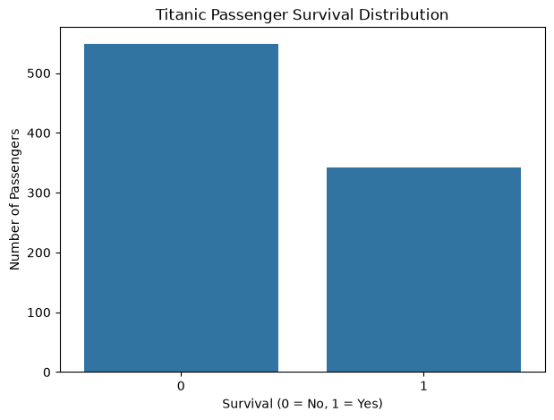
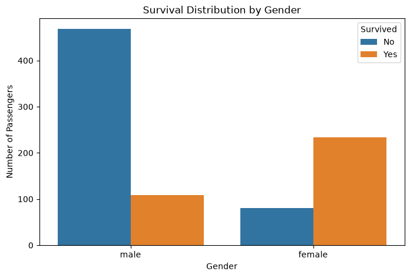
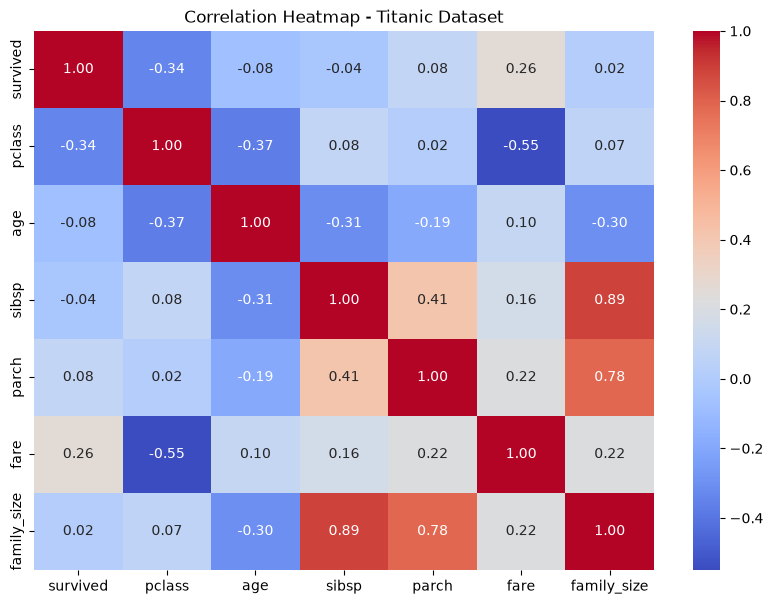
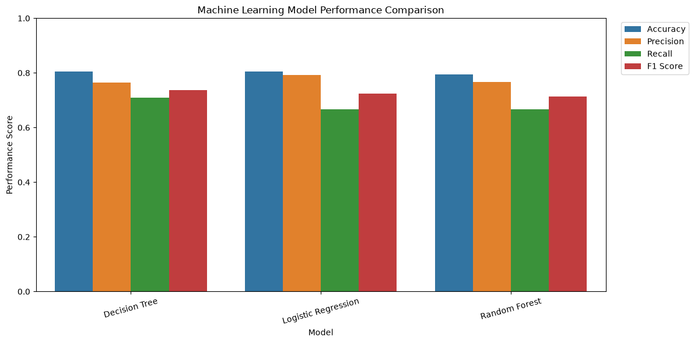
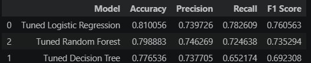
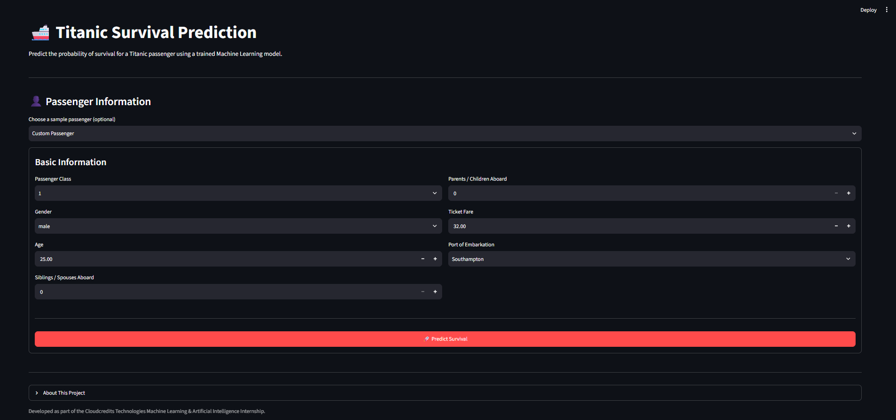
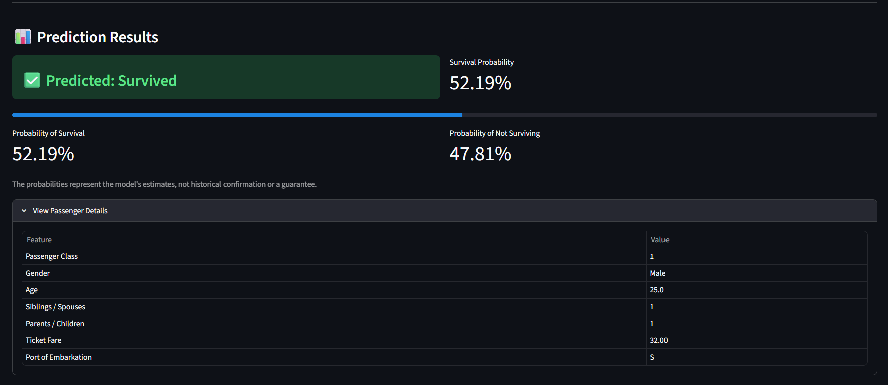

# Titanic Survival Prediction

A machine-learning project that estimates the probability of survival
for a Titanic passenger using passenger and ticket information. The
workflow includes exploratory data analysis (EDA), preprocessing, model
comparison, cross-validation, hyperparameter tuning, feature
interpretation, reusable Python modules, and a Streamlit application.

> **Important:** This model estimates outcomes from patterns in the training dataset. It does not establish what happened to any individual historical passenger.

## Project Overview

The objective is to build a binary classification model to predict
whether a passenger survived (`1`) or did not survive (`0`).

The application accepts seven features: passenger class (`pclass`), sex
(`sex`), age (`age`), siblings/spouses aboard (`sibsp`),
parents/children aboard (`parch`), ticket fare (`fare`), and port of
embarkation (`embarked`).

The deployed model is a tuned **Logistic Regression** pipeline.
Preprocessing is included in the saved scikit-learn pipeline to ensure
consistent transformations during training and prediction.

## Project Highlights

-   Explored 891 passenger records and 15 original columns.
-   Investigated missing values, distributions, correlations, and
    survival patterns.
-   Built numerical and categorical preprocessing pipelines.
-   Compared Logistic Regression, Decision Tree, and Random Forest
    classifiers.
-   Used five-fold stratified cross-validation and `RandomizedSearchCV`.
-   Selected tuned Logistic Regression for the Streamlit application.
-   Created reusable Python modules under `src/`.
-   Built and tested an interactive Streamlit application.

## Dataset

**Dataset:** Titanic passenger dataset distributed through Seaborn's
example-data repository. The working CSV is stored at
`data/titanic.csv`.

  Property                  Value
  ------------------ ------------
  Rows                        891
  Original columns             15
  Target               `survived`
  Training rows               712
  Test rows                   179

Target distribution:

  Outcome                   Passengers    Share
  ----------------------- ------------ --------
  Did not survive (`0`)            549   61.62%
  Survived (`1`)                   342   38.38%

### Missing values

  Column            Missing values   Missing share
  --------------- ---------------- ---------------
  `age`                        177          19.87%
  `embarked`                     2           0.22%
  `deck`                       688          77.22%
  `embark_town`                  2           0.22%

The deployed model uses seven selected features. `deck` and
`embark_town` are not model inputs.

A duplicate-row check identified 107 rows identical across the available
columns checked. These were not automatically removed: without a unique
passenger identifier, identical feature rows alone do not prove
accidental duplication.

## Exploratory Data Analysis

### Survival distribution



### Survival by gender



  Gender     Observed survival rate
  -------- ------------------------
  Female                     74.20%
  Male                       18.89%

### Survival by passenger class


### Age distribution by survival


  Age group       Survival rate
  ------------- ---------------
  Child                  57.97%
  Teenager               42.86%
  Young Adult            38.28%
  Adult                  40.00%
  Senior                 22.73%

Age groups were used for exploratory analysis; the deployed model uses
numerical `age`.

### Correlation analysis



  Feature           Correlation with `survived`
  --------------- -----------------------------
  `pclass`                                -0.34
  `fare`                                  +0.26
  `age`                                   -0.08
  `sibsp`                                 -0.04
  `parch`                                 +0.08
  `family_size`                           +0.02

The exploratory family-size feature was calculated as
`family_size = sibsp + parch + 1`. These are descriptive associations,
not evidence of causation. Some family-size groups had few observations
and should be interpreted cautiously.

## Data Preparation and Preprocessing

The model features are:

``` python
FEATURES = [
    "pclass", "sex", "age", "sibsp", "parch", "fare", "embarked"
]
```

The target is `survived`. The data was split 80:20 using
`random_state=42` and stratification by target.

  Split        Rows
  ---------- ------
  Training      712
  Test          179

Preprocessing uses scikit-learn `Pipeline` and `ColumnTransformer`.

  -----------------------------------------------------------------------
  Feature type            Features                Processing
  ----------------------- ----------------------- -----------------------
  Numerical               `age`, `sibsp`,         Median imputation, then
                          `parch`, `fare`         standard scaling

  Categorical             `pclass`, `sex`,        Most-frequent
                          `embarked`              imputation, then
                                                  one-hot encoding
  -----------------------------------------------------------------------

The transformed data contains 12 features: four numerical and eight
one-hot encoded categorical features.

## Model Development

Three baseline classifiers were evaluated: Logistic Regression, Decision
Tree, and Random Forest.

### Baseline test-set results



  Model                   Accuracy   Precision   Recall   F1-score
  --------------------- ---------- ----------- -------- ----------
  Logistic Regression       80.45%      79.31%   66.67%     72.44%
  Decision Tree             80.45%      76.56%   71.01%     73.68%
  Random Forest             79.33%      76.67%   66.67%     71.32%

### Five-fold cross-validation on training data

  Model                   Mean accuracy   Mean precision   Mean recall   Mean F1-score
  --------------------- --------------- ---------------- ------------- ---------------
  Logistic Regression            80.20%           76.52%        69.97%          73.01%
  Random Forest                  79.77%           75.09%        71.06%          72.94%
  Decision Tree                  76.97%           70.57%        68.90%          69.59%

## Hyperparameter Tuning

`RandomizedSearchCV` was used with five-fold stratified cross-validation
and F1-score as the search metric.

  ------------------------------------------------------------------------------
  Model                 Best parameters from the                      Best CV F1
                        latest training-script run  
  --------------------- --------------------------- ----------------------------
  Logistic Regression   `C=1`,                                            0.7305
                        `class_weight='balanced'`   

  Decision Tree         `max_depth=5`,                                    0.7448
                        `min_samples_split=5`,      
                        `min_samples_leaf=1`,       
                        `class_weight='balanced'`   

  Random Forest         `n_estimators=200`,                               0.7657
                        `max_depth=10`,             
                        `min_samples_split=2`,      
                        `min_samples_leaf=2`,       
                        `max_features='sqrt'`,      
                        `class_weight='balanced'`   
  ------------------------------------------------------------------------------

### Tuned model test-set results



  Model                     Accuracy   Precision       Recall     F1-score
  --------------------- ------------ ----------- ------------ ------------
  Logistic Regression     **81.01%**      73.97%   **78.26%**   **76.06%**
  Decision Tree               77.65%      73.77%       65.22%       69.23%
  Random Forest               79.89%      74.63%       72.46%       73.53%

Tuned Logistic Regression was selected for the application because it
achieved the strongest recorded test accuracy and positive-class
F1-score among the tuned candidates. Tuned Random Forest achieved the
highest cross-validation F1-score during the search.

### Final Logistic Regression evaluation


Confusion matrix:

  Actual / Predicted     Did not survive   Survived
  -------------------- ----------------- ----------
  Did not survive                     91         19
  Survived                            15         54


### Baseline confusion matrices


> **Evaluation caveat:** Test-set results were consulted repeatedly
> during model comparison and selection. Treat them as development
> results, not a fully untouched final estimate of generalisation
> performance. A separate final holdout set or nested cross-validation
> would provide a stronger final evaluation.

## Feature Engineering Experiment

Additional features explored included `family_size`, `is_alone`,
`fare_per_person`, and `age_group`.

The engineered Logistic Regression model achieved approximately 79.33%
accuracy, which did not improve on the tuned Logistic Regression model
using the original seven features (81.01% on the same development test
split). The engineered features were therefore not included in the
deployed model.

## Feature Importance

Impurity-based feature importance from the tuned Random Forest model:


  Feature          Importance
  -------------- ------------
  `sex_male`           0.2167
  `fare`               0.1993
  `sex_female`         0.1928
  `age`                0.1557
  `pclass_3`           0.0603
  `pclass_1`           0.0431
  `sibsp`              0.0391
  `parch`              0.0341
  `pclass_2`           0.0203
  `embarked_S`         0.0184
  `embarked_C`         0.0117
  `embarked_Q`         0.0085

These values describe how the fitted Random Forest used features to
reduce impurity. They do not establish causal effects. This analysis is
from the tuned Random Forest; the application deploys Logistic
Regression.

## Streamlit Application

The application allows users to enter passenger details or choose a
sample passenger preset and receive: - Predicted class: survived or did
not survive. - Estimated survival probability. - Estimated probability
of not surviving. - An expandable summary of passenger details.

The saved scikit-learn pipeline applies preprocessing consistently
during prediction.

### Application screenshots






### Run locally

From the project root, activate your virtual environment and install
dependencies:

``` bash
pip install -r requirements.txt
```

Start the application:

``` bash
streamlit run app.py
```

The Streamlit application loads:

``` text
models/titanic_survival_model_retained.pkl
```

## Project Architecture

``` text
01_Titanic_Survival_Prediction/
│
├── data/
│   └── titanic.csv
├── images/
│   ├── 01_survival_distribution.png
│   ├── ...
│   └── 16_prediction_result.png
├── models/
│   └── titanic_survival_model_retained.pkl
├── notebooks/
│   └── 01_Titanic_EDA.ipynb
├── reports/
│   └── Titanic_Survival_Prediction_Project_Report.pdf
├── src/
│   ├── __init__.py
│   ├── preprocessing.py
│   ├── train_model.py
│   └── predict.py
├── .gitignore
├── app.py
├── README.md
├── requirements.txt
└── test_prediction.py
```

### Source modules

  -----------------------------------------------------------------------
  File                                Responsibility
  ----------------------------------- -----------------------------------
  `src/preprocessing.py`              Defines numerical and categorical
                                      preprocessing pipelines

  `src/train_model.py`                Loads data, splits it, trains
                                      baseline models, cross-validates,
                                      tunes, evaluates, and saves the
                                      selected model

  `src/predict.py`                    Loads the saved model and provides
                                      a reusable prediction function

  `app.py`                            Provides the Streamlit user
                                      interface

  `test_prediction.py`                Runs an independent prediction test

  `notebooks/01_Titanic_EDA.ipynb`    Records exploratory analysis and
                                      modelling experiments
  -----------------------------------------------------------------------

## Run Model Training

From the project root:

``` bash
python src/train_model.py
```

The script saves the newly trained selected model to:

``` text
models/titanic_survival_model_retained.pkl
```

The original `models/titanic_survival_model.pkl` is retained separately.
The Streamlit application uses the `retained` model file.

## Run the Independent Prediction Test

From the project root:

``` bash
python test_prediction.py
```

The script uses sample passenger details and prints the predicted class
and both class probabilities.

## Technologies Used

-   Python
-   Pandas and NumPy
-   Matplotlib and Seaborn
-   Scikit-learn
-   Streamlit
-   Joblib
-   Jupyter Notebook

## Skills Demonstrated

-   Data loading, inspection, and quality checks
-   Missing-value analysis
-   Exploratory data analysis and visualisation
-   Feature selection and feature engineering
-   Numerical and categorical preprocessing
-   Classification model training and comparison
-   Cross-validation and hyperparameter tuning
-   Evaluation using accuracy, precision, recall, and F1-score
-   Model interpretation
-   Modular Python development
-   Model serialization and inference
-   Interactive application development with Streamlit

## Limitations and Future Improvements

-   Evaluate the selected model on a genuinely untouched holdout dataset
    or use nested cross-validation.
-   Add automated tests for input validation and prediction behaviour.
-   Compare probability calibration and reliability, not only
    classification metrics.
-   Explore explainability methods such as permutation importance or
    SHAP.
-   Add deployment instructions for a hosted Streamlit application.
-   Record dataset provenance and licensing details before
    redistributing the raw data.

## Acknowledgements

This project was developed as part of the **Cloudcredits Technologies
Machine Learning & Artificial Intelligence virtual internship**.

The Titanic dataset used for the project is distributed through the
Seaborn example-data repository. Review the dataset repository and its
terms before redistributing the raw data.

------------------------------------------------------------------------

**Project status:** EDA, model training, evaluation, serialization,
reusable prediction code, and local Streamlit application testing
completed. Final PDF report, demo recording, and repository publication
remain as submission tasks.
